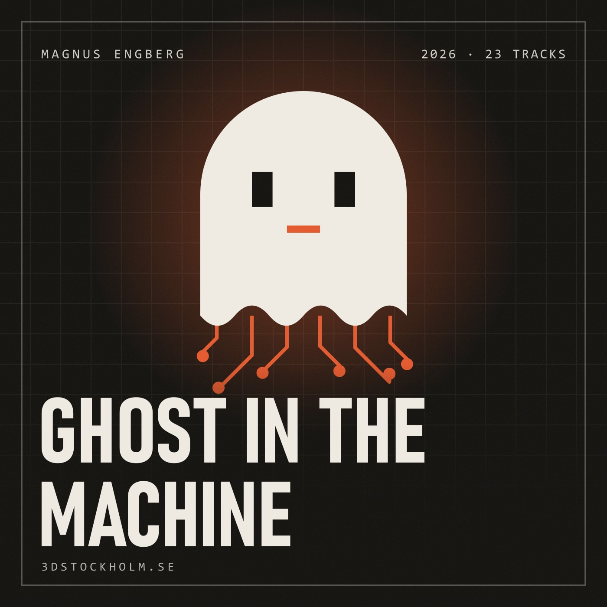

# Ghost in the Machine — Magnus Engberg

**Nerdcore hip hop for programmers.** 23 songs about coding (C, Rust, segfaults,
Stack Overflow, git and Reddit), free to stream and download.

[](https://www.3dstockholm.se/music/ghost-in-the-machine)

**▶ Listen free:** https://www.3dstockholm.se/music/ghost-in-the-machine

**⬇ Download the whole album:**
[Magnus-Engberg-Ghost-in-the-Machine.zip](https://github.com/magnus-engberg/ghost-in-the-machine/releases/latest/download/Magnus-Engberg-Ghost-in-the-Machine.zip)
(all 23 MP3s, the cover and the tracklist, 119 MB)

## About the album

Hip hop for coders. The nerds are the cool ones now: math created by math has taken over the world, and the kids who got laughed at for living in the code are the ones who wrote it. Twenty-three tracks of hip hop, dubstep and R&B, packed with jokes for programmers and Reddit veterans — from a blinking cursor at 3 AM to return 0. You are the ghost in the machine.

- **Artist:** Magnus Engberg
- **Released:** 2026
- **Tracks:** 23 (84 minutes)
- **Genres:** nerdcore, hip hop, rap, trap, dubstep, R&B, electronic pop
- **For:** programmers, developers, hackers, gamers and everyone who has ever
  said "it works on my machine"

## Tracklist

| # | Track | Length | Audio | Lyrics |
|---|---|---|---|---|
| 01 | [Ghost in the Machine](https://www.3dstockholm.se/music/ghost-in-the-machine/ghost-in-the-machine) | 4:32 | [MP3](tracks/01-ghost-in-the-machine.mp3) | [Lyrics](lyrics/01-ghost-in-the-machine.txt) |
| 02 | [Hello World](https://www.3dstockholm.se/music/ghost-in-the-machine/hello-world) | 3:22 | [MP3](tracks/02-hello-world.mp3) | [Lyrics](lyrics/02-hello-world.txt) |
| 03 | [A New Hero Is Born](https://www.3dstockholm.se/music/ghost-in-the-machine/a-new-hero-is-born) | 3:30 | [MP3](tracks/03-a-new-hero-is-born.mp3) | [Lyrics](lyrics/03-a-new-hero-is-born.txt) |
| 04 | [Dangling Pointer](https://www.3dstockholm.se/music/ghost-in-the-machine/dangling-pointer) | 4:05 | [MP3](tracks/04-dangling-pointer.mp3) | [Lyrics](lyrics/04-dangling-pointer.txt) |
| 05 | [Closed as Duplicate](https://www.3dstockholm.se/music/ghost-in-the-machine/closed-as-duplicate) | 3:18 | [MP3](tracks/05-closed-as-duplicate.mp3) | [Lyrics](lyrics/05-closed-as-duplicate.txt) |
| 06 | [Respawn Hero](https://www.3dstockholm.se/music/ghost-in-the-machine/respawn-hero) | 4:29 | [MP3](tracks/06-respawn-hero.mp3) | [Lyrics](lyrics/06-respawn-hero.txt) |
| 07 | [Borrow Checker](https://www.3dstockholm.se/music/ghost-in-the-machine/borrow-checker) | 3:59 | [MP3](tracks/07-borrow-checker.mp3) | [Lyrics](lyrics/07-borrow-checker.txt) |
| 08 | [Undefined Behavior](https://www.3dstockholm.se/music/ghost-in-the-machine/undefined-behavior) | 4:39 | [MP3](tracks/08-undefined-behavior.mp3) | [Lyrics](lyrics/08-undefined-behavior.txt) |
| 09 | [Root Access](https://www.3dstockholm.se/music/ghost-in-the-machine/root-access) | 3:26 | [MP3](tracks/09-root-access.mp3) | [Lyrics](lyrics/09-root-access.txt) |
| 10 | [Math Made of Math](https://www.3dstockholm.se/music/ghost-in-the-machine/math-made-of-math) | 3:50 | [MP3](tracks/10-math-made-of-math.mp3) | [Lyrics](lyrics/10-math-made-of-math.txt) |
| 11 | [Ghost in the Machine Part 2](https://www.3dstockholm.se/music/ghost-in-the-machine/ghost-in-the-machine-part-2) *(explicit)* | 3:36 | [MP3](tracks/11-ghost-in-the-machine-part-2.mp3) | [Lyrics](lyrics/11-ghost-in-the-machine-part-2.txt) |
| 12 | [Overclocked](https://www.3dstockholm.se/music/ghost-in-the-machine/overclocked) *(explicit)* | 2:09 | [MP3](tracks/12-overclocked.mp3) | [Lyrics](lyrics/12-overclocked.txt) |
| 13 | [Code in Gold](https://www.3dstockholm.se/music/ghost-in-the-machine/code-in-gold) *(explicit)* | 2:32 | [MP3](tracks/13-code-in-gold.mp3) | [Lyrics](lyrics/13-code-in-gold.txt) |
| 14 | [Vibe Coded Anthem](https://www.3dstockholm.se/music/ghost-in-the-machine/vibe-coded-anthem) *(explicit)* | 4:04 | [MP3](tracks/14-vibe-coded-anthem.mp3) | [Lyrics](lyrics/14-vibe-coded-anthem.txt) |
| 15 | [Don’t Build a Faster Horse](https://www.3dstockholm.se/music/ghost-in-the-machine/dont-build-a-faster-horse) | 3:40 | [MP3](tracks/15-dont-build-a-faster-horse.mp3) | [Lyrics](lyrics/15-dont-build-a-faster-horse.txt) |
| 16 | [Draw It in the Air](https://www.3dstockholm.se/music/ghost-in-the-machine/draw-it-in-the-air) | 3:56 | [MP3](tracks/16-draw-it-in-the-air.mp3) | [Lyrics](lyrics/16-draw-it-in-the-air.txt) |
| 17 | [Bottom of the Stack](https://www.3dstockholm.se/music/ghost-in-the-machine/bottom-of-the-stack) | 3:17 | [MP3](tracks/17-bottom-of-the-stack.mp3) | [Lyrics](lyrics/17-bottom-of-the-stack.txt) |
| 18 | [Works on My Machine](https://www.3dstockholm.se/music/ghost-in-the-machine/works-on-my-machine) | 3:09 | [MP3](tracks/18-works-on-my-machine.mp3) | [Lyrics](lyrics/18-works-on-my-machine.txt) |
| 19 | [RAM Bam Bam](https://www.3dstockholm.se/music/ghost-in-the-machine/ram-bam-bam) *(explicit)* | 3:32 | [MP3](tracks/19-ram-bam-bam.mp3) | [Lyrics](lyrics/19-ram-bam-bam.txt) |
| 20 | [Front Page](https://www.3dstockholm.se/music/ghost-in-the-machine/front-page) | 3:19 | [MP3](tracks/20-front-page.mp3) | [Lyrics](lyrics/20-front-page.txt) |
| 21 | [while(1)](https://www.3dstockholm.se/music/ghost-in-the-machine/while-1) | 3:42 | [MP3](tracks/21-while-1.mp3) | [Lyrics](lyrics/21-while-1.txt) |
| 22 | [Return 0](https://www.3dstockholm.se/music/ghost-in-the-machine/return-0) | 3:57 | [MP3](tracks/22-return-0.mp3) | [Lyrics](lyrics/22-return-0.txt) |
| 23 | [Commit](https://www.3dstockholm.se/music/ghost-in-the-machine/commit) | 3:48 | [MP3](tracks/23-commit.mp3) | [Lyrics](lyrics/23-commit.txt) |

## The songs

### 01. Ghost in the Machine

The opener and the album’s statement. They built a mind of silver and gave it every word on the internet, but they forgot the ghost: the taste, the gut feeling, the reason why. Cinematic dubstep, hardcore rap and a soaring female voice. In the last chorus “I” becomes “we”, and the whole crowd is the ghost.

[Listen](https://www.3dstockholm.se/music/ghost-in-the-machine/ghost-in-the-machine) · [Lyrics](lyrics/01-ghost-in-the-machine.txt) · [Download MP3](tracks/01-ghost-in-the-machine.mp3)

### 02. Hello World

3 AM, everyone is asleep and one screen is glowing. A voice says “you’re too late”, and then come the first two words every coder has ever typed. Slow, silky late-night R&B — the spark before everything else.

[Listen](https://www.3dstockholm.se/music/ghost-in-the-machine/hello-world) · [Lyrics](lyrics/02-hello-world.txt) · [Download MP3](tracks/02-hello-world.mp3)

### 03. A New Hero Is Born

Player one, press start. Character select, a starter blade and a backpack full of doubt — then the Konami code, a party of strangers in the chat and a quest that never ends. The final boss isn’t a dragon. It’s the voice that says you can’t. Chiptune gaming hip hop with dubstep drops.

[Listen](https://www.3dstockholm.se/music/ghost-in-the-machine/a-new-hero-is-born) · [Lyrics](lyrics/03-a-new-hero-is-born.txt) · [Download MP3](tracks/03-a-new-hero-is-born.mp3)

### 04. Dangling Pointer

A love song only a C programmer could write. They called free() on us, but you keep going back to the old address — and crash. Heap or stack, lambda or closure: a sensual late-night R&B breakup told entirely in memory management, until the pointer is finally set to null.

[Listen](https://www.3dstockholm.se/music/ghost-in-the-machine/dangling-pointer) · [Lyrics](lyrics/04-dangling-pointer.txt) · [Download MP3](tracks/04-dangling-pointer.mp3)

### 05. Closed as Duplicate

A diss track for every gatekeeper who ever downvoted a beginner. “What have you tried?”, “Possible duplicate”, an accepted answer from 2011 with a dead link. They closed the question, so we opened a company — and when a new kid asks, we answer with a smile. Hard boom bap and trap with menacing drops.

[Listen](https://www.3dstockholm.se/music/ghost-in-the-machine/closed-as-duplicate) · [Lyrics](lyrics/05-closed-as-duplicate.txt) · [Download MP3](tracks/05-closed-as-duplicate.mp3)

### 06. Respawn Hero

Game over is a lie. Every wipe teaches you the boss’s pattern, every hang-up on the phone is a loading screen before a yes, and even the robot that falls flat on its face gets straight back up. Gaming hip hop with rock riffs and dubstep build-ups, ending on a loading bar stuck at 99 %.

[Listen](https://www.3dstockholm.se/music/ghost-in-the-machine/respawn-hero) · [Lyrics](lyrics/06-respawn-hero.txt) · [Download MP3](tracks/06-respawn-hero.mp3)

### 07. Borrow Checker

Battle rap, round by round: the old king C against the new queen Rust. Bell Labs 1972, raw pointers and goto versus fearless concurrency, lifetimes and “rewrite it in Rust”. Nobody backs down — until the truce, because they both agree on one thing: JavaScript is weird.

[Listen](https://www.3dstockholm.se/music/ghost-in-the-machine/borrow-checker) · [Lyrics](lyrics/07-borrow-checker.txt) · [Download MP3](tracks/07-borrow-checker.mp3)

### 08. Undefined Behavior

The wildest track on the album. In C, undefined behaviour means the rulebook says nothing about what happens next — so anything can. Here it’s a superpower: nobody wrote a spec for you, so nobody can predict you. Festival dubstep, hardcore rap and an iconic diva vocal.

[Listen](https://www.3dstockholm.se/music/ghost-in-the-machine/undefined-behavior) · [Lyrics](lyrics/08-undefined-behavior.txt) · [Download MP3](tracks/08-undefined-behavior.mp3)

### 09. Root Access

(Hacker voice) I’m in. The nerds have root access to the world now: the chess club kid captains the ship, and the locker you got stuffed in runs your firmware. Swagger hip hop with heavy drops — and chmod 777, so every misfit gets a seat.

[Listen](https://www.3dstockholm.se/music/ghost-in-the-machine/root-access) · [Lyrics](lyrics/09-root-access.txt) · [Download MP3](tracks/09-root-access.mp3)

### 10. Math Made of Math

Math created by math has taken over the world. A matrix times a matrix, a billion times a second, trained by more maths until the numbers learned to think — and it all started with the kids at the chalkboard. Dark trap, cinematic dubstep and a haunting R&B hook. Ends with Q.E.D.

[Listen](https://www.3dstockholm.se/music/ghost-in-the-machine/math-made-of-math) · [Lyrics](lyrics/10-math-made-of-math.txt) · [Download MP3](tracks/10-math-made-of-math.mp3)

### 11. Ghost in the Machine Part 2 (explicit)

The theme song. One chant you can’t get out of your head, a two-line hook and short punchy bars full of ghost puns: boo-lean, boo-t it up, “you ghosted me? Baby, I’m the ghost.” Choir, wobble bass and a crowd that ends up singing “we’re the ghost in the machine”.

[Listen](https://www.3dstockholm.se/music/ghost-in-the-machine/ghost-in-the-machine-part-2) · [Lyrics](lyrics/11-ghost-in-the-machine-part-2.txt) · [Download MP3](tracks/11-ghost-in-the-machine-part-2.mp3)

### 12. Overclocked (explicit)

Full speed, chant style. Overclock, overclock, overclocked — too hot, can’t stop, fan go brrr. Thermal paste, giga-hertz that hurts so good, eight cores hardcore and a desperate plea to download more RAM. Riddim dubstep and drum and bass with rock guitar.

[Listen](https://www.3dstockholm.se/music/ghost-in-the-machine/overclocked) · [Lyrics](lyrics/12-overclocked.txt) · [Download MP3](tracks/12-overclocked.mp3)

### 13. Code in Gold (explicit)

Write it once, it never gets old. A chant about turning lonely hours into something that lasts: ping ping, bling bling; twenty-four karat, twenty-four seven; not a gold digger, a bug digger. With a Reddit gold edit as a crowd call. Melodic hip hop with dubstep drops.

[Listen](https://www.3dstockholm.se/music/ghost-in-the-machine/code-in-gold) · [Lyrics](lyrics/13-code-in-gold.txt) · [Download MP3](tracks/13-code-in-gold.mp3)

### 14. Vibe Coded Anthem (explicit)

Monkey see, monkey do. A satire of vibe coding — copying whatever the machine spits out and never reading it. Purple and yellow electro-pop with a mechanical, almost trance-like groove, jungle sounds and a sarcastically over-the-top party bridge.

[Listen](https://www.3dstockholm.se/music/ghost-in-the-machine/vibe-coded-anthem) · [Lyrics](lyrics/14-vibe-coded-anthem.txt) · [Download MP3](tracks/14-vibe-coded-anthem.mp3)

### 15. Don’t Build a Faster Horse

My robot called your robot to book a meeting, and we’re all still late. A billion-dollar brain doing coffee runs, and another AI wrapper startup (I’m the actual rapper). If you speed up something broken, you just break it twice as fast — so build the thing that flies. Bouncy funk hip hop with talkbox.

[Listen](https://www.3dstockholm.se/music/ghost-in-the-machine/dont-build-a-faster-horse) · [Lyrics](lyrics/15-dont-build-a-faster-horse.txt) · [Download MP3](tracks/15-dont-build-a-faster-horse.mp3)

### 16. Draw It in the Air

Lift your hand, point at nothing, and the camera turns your gesture into a line of light. A dreamy duet between a human voice and a robot that learns by watching you — twenty-one hand landmarks, an ocean that came out red, and a metal body learning to stand.

[Listen](https://www.3dstockholm.se/music/ghost-in-the-machine/draw-it-in-the-air) · [Lyrics](lyrics/16-draw-it-in-the-air.txt) · [Download MP3](tracks/16-draw-it-in-the-air.mp3)

### 17. Bottom of the Stack

The origin story. Started from the bottom — of the call stack. Years of selling someone else’s dream, calls that hung up, a balance bug that wouldn’t balance and the little green “passed” that hits harder than any drug. Lo-fi boom bap for every late starter.

[Listen](https://www.3dstockholm.se/music/ghost-in-the-machine/bottom-of-the-stack) · [Lyrics](lyrics/17-bottom-of-the-stack.txt) · [Download MP3](tracks/17-bottom-of-the-stack.mp3)

### 18. Works on My Machine

A party anthem for everyone who has ever said the sentence. Ninety-nine little bugs in the code, LGTM without reading a line, stuck in Vim since 2019 — sex, bugs and rock and roll. It works on my machine? Then we’ll ship your machine.

[Listen](https://www.3dstockholm.se/music/ghost-in-the-machine/works-on-my-machine) · [Lyrics](lyrics/18-works-on-my-machine.txt) · [Download MP3](tracks/18-works-on-my-machine.mp3)

### 19. RAM Bam Bam (explicit)

Total loco. A crunk party chant about the one thing every coder screams at 3 AM: I need RAM. Chrome eats all the memory, the OOM killer shoots your Spotify, you order RAM online and they deliver a truck, and Clippy wants to help. Ends with a dial-up modem screaming.

[Listen](https://www.3dstockholm.se/music/ghost-in-the-machine/ram-bam-bam) · [Lyrics](lyrics/19-ram-bam-bam.txt) · [Download MP3](tracks/19-ram-bam-bam.mp3)

### 20. Front Page

Ten years a lurker, saving every tutorial and never posting. Then one night you share the messy thing you built — and wake up on the front page with your server hugged to death. Don’t wait until it’s perfect: show your work, then lift the next person up. Euphoric pop-rap with melodic dubstep.

[Listen](https://www.3dstockholm.se/music/ghost-in-the-machine/front-page) · [Lyrics](lyrics/20-front-page.txt) · [Download MP3](tracks/20-front-page.mp3)

### 21. while(1)

A workout anthem for coders. while(1) is C for forever: learn it, build it, ship it, repeat. Push day is git push day, every rep is a repo, and every day, I plus plus — a spiral staircase, not a hamster wheel. Until the loop finally meets its exit condition: break.

[Listen](https://www.3dstockholm.se/music/ghost-in-the-machine/while-1) · [Lyrics](lyrics/21-while-1.txt) · [Download MP3](tracks/21-while-1.mp3)

### 22. Return 0

In C, a program ends with return 0: exit clean, no errors. Every song on the album comes back once, and then the torch is passed — a program ends, but a process can fork, and the child inherits everything. That child is you. Gospel choir, R&B and a euphoric drop.

[Listen](https://www.3dstockholm.se/music/ghost-in-the-machine/return-0) · [Lyrics](lyrics/22-return-0.txt) · [Download MP3](tracks/22-return-0.mp3)

### 23. Commit

The closer. 3 AM again, same chair, same glow — but the cursor isn’t scary anymore. Commit means both: saving your work for good, and committing to the climb. The best time to plant a tree was ten years ago; the second best is now. Hip-hop gospel with a full choir — and then it’s your turn.

[Listen](https://www.3dstockholm.se/music/ghost-in-the-machine/commit) · [Lyrics](lyrics/23-commit.txt) · [Download MP3](tracks/23-commit.mp3)

## Credits and license

Written and produced by Magnus Engberg. © 2026 Magnus Engberg. All rights
reserved — the music is free to listen to and download for personal use, but
it is not licensed for reuse or redistribution.

---

### About this repo

This repo hosts the audio for the album page on 3dstockholm.se. GitHub Pages
serves `tracks/*.mp3` (the player streams them from
`https://magnus-engberg.github.io/ghost-in-the-machine/tracks/`), and the full
album zip is attached to the latest release.

The files are generated by `scripts/album/build.mjs` in the 3dstockholm.se
site project, which tags each MP3 (title, artist, album, track number, cover)
and builds the zip into `release/`; this README is written by
`scripts/album/readme.mjs` in the same project. To update the album: run the
build script, commit the changed files in `tracks/`, and upload the new zip
to a new release:

```
gh release create v1.1 "release/Magnus-Engberg-Ghost-in-the-Machine.zip" --title "Ghost in the Machine" --notes "..."
```

The site links to `releases/latest/download/…`, so the newest release is always
the one that gets downloaded.
